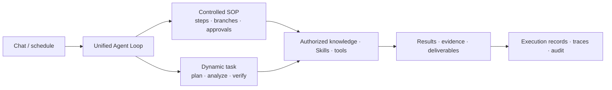

<p align="center">
  
</p>

<h1 align="center">Gongge Xuban · 共格·序伴</h1>

<p align="center">
  <strong>AI that follows your processes and works through complex tasks</strong><br />
  Build, run, and govern digital employees for personal work and teams
</p>

<p align="center">
  
  
  
</p>

<p align="center">
  <a href="https://github.com/CalmBuilder/gongge-xuban/releases">Windows download</a> ·
  <a href="#highlights">Highlights</a> ·
  <a href="#get-started">Get started</a> ·
  <a href="#documentation-and-source">Documentation</a> ·
  <a href="README.md">中文</a>
</p>

Equip a digital employee with a role, model, knowledge, and tools. Handle **repeatable business processes** and **open-ended work that needs planning** in one workspace, with execution records, evidence, and deliverables.

## Highlights

- **Two execution modes, one workspace.** Controlled SOPs handle leave requests, expenses, and contract review. Dynamic tasks plan research, document analysis, and information synthesis around a goal and success criteria.
- **273 Chinese expert templates to choose from.** The reviewed Agency Agents package ships with each release. Select a template in the gallery, then bind the knowledge, Skills, SOPs, and tools your role needs.
- **Bring knowledge and methods into the work.** Combine citations, `SKILL.md` guidance, HTTP/MCP tools, and attachment analysis to produce grounded answers and downloadable deliverables.
- **Keep track of work while it waits.** Persist progress, pause for clarification, approval, or external results, and support cancellation and recovery. Work items, traces, and audit records help people take over.
- **Turn feedback into the next SOP version.** Users explicitly share feedback materials; managers can create an isolated improvement candidate, inspect the changes, and publish it. Existing tasks keep their original version.
- **Start locally; deploy for a team when needed.** The Windows installer bundles its runtimes. SQLite is the default, while MySQL 8.4 supports self-hosted services with tenant, role, and organization controls.

## What can you use it for?

| Work | Example request | How it is handled |
| --- | --- | --- |
| Process requests | “Start a leave, expense, or access request.” | SOP input collection, branches, human work items, and approvals |
| Documents and research | “Compare these policies, cite the differences, and produce a report.” | Dynamic plan + attachments + knowledge / Skills + deliverable verification |
| Analysis within a process | “Review this contract and send the risks to the responsible reviewer.” | SOP owns the process; knowledge and Skills support analysis; people make key decisions |
| Scheduled work | “Periodically compile a briefing on this topic.” | A schedule triggers a configured digital employee and preserves execution records |
| Reusable team methods | “Use the problems in this SOP run to propose an improvement.” | Authorized materials → isolated candidate → diff confirmation → human publication |

These scenarios require a working model and the relevant knowledge, Skills, SOPs, or tools. Real approvals and business-system actions require integration with your systems and identities.

## Get started

### Windows installer

Download `Gongge-Xuban-windows-x64-setup.exe` from [Releases](https://github.com/CalmBuilder/gongge-xuban/releases), install it, and launch the shortcut. The installer includes the application and supporting Python and Node.js runtimes. The workspace opens in your browser.

Configure a model in the management console, then choose an expert or create your own digital employee. You provide model and business-system credentials. See [Windows native validation](packaging/WINDOWS_NATIVE_VALIDATION.md) for build and acceptance details.

### Run from source

Requires **Python 3.11+, Node.js 20+, and npm**. SQLite is the default, so no database server is needed to get started.

```bash
git clone https://github.com/CalmBuilder/gongge-xuban.git
cd gongge-xuban
```

<details>
<summary>macOS / Linux / WSL setup</summary>

```bash
cd backend
python3.11 -m venv .venv
source .venv/bin/activate
pip install -e ".[dev]"
test -f .env || cp .env.example .env

cd ../frontend-enterprise
npm ci
cd ..
```

</details>

<details>
<summary>Windows PowerShell setup</summary>

```powershell
cd backend
py -3.11 -m venv .venv
.\.venv\Scripts\python.exe -m pip install -e ".[dev]"
if (-not (Test-Path .env)) { Copy-Item .env.example .env }

cd ..\frontend-enterprise
npm ci
cd ..
```

</details>

1. Edit `backend/.env` using the [configuration example](backend/.env.example), and set `PUBLIC_MOCK_API_KEY` to your own random value. Preserve existing configuration.
2. From the repository root, run `./app.sh dev`, or `.\app.ps1 dev` in Windows PowerShell.
3. Open [Chat](http://localhost:5137/chat/) or the [Management console](http://localhost:5137/enterprise/dashboard). Configure an **OpenAI Chat Completions-compatible model** in the console.
4. Choose an expert or create a digital employee, bind its resources, and start a task. Health is available at `http://localhost:5137/api/health`; API documentation is at `http://localhost:5137/docs`.

| Operation | macOS / Linux / WSL | Windows PowerShell |
| --- | --- | --- |
| Foreground development | `./app.sh dev` | `.\app.ps1 dev` |
| Background operation | `./app.sh` | `.\app.ps1` |
| Status | `./app.sh status` | `.\app.ps1 status` |
| Stop | `./app.sh stop` | `.\app.ps1 stop` |

## How the execution modes work together

**Controlled SOPs** suit stable steps, clear responsibility, approvals, and business records. **Dynamic tasks** suit clear goals whose steps require judgment. Both share the Agent Loop, capability catalog, and execution governance.



| | Controlled SOP | Dynamic task |
| --- | --- | --- |
| Starts with | A published process definition and version | A goal and success criteria |
| Progresses through | Input collection, branches, service nodes, and human work items | A bounded plan combining knowledge, Skills, tools, and attachments |
| Waits for | Confirmation, approval, human handling, or external events | Missing information, approval, reauthorization, or external results |
| Delivers | Per-node results and business receipts | Results checked against success criteria, evidence, and deliverables |

Select `DynamicTaskAgent` in the composer for complex work, or leave routing automatic. An active SOP continues to own subsequent messages until it ends; the current engine selection applies afterward.

<details>
<summary>Execution constraints and recovery</summary>

- Versioned SOP state machines support `collect_input`, `decision`, `service_task`, `human_task`, and `terminal` nodes, with candidate/organization scopes, reviewer separation, and completion thresholds.
- Ordinary answers, knowledge, Skills, attachments, artifacts, and read-only dynamic tools are baseline capabilities. Empty tenant or employee allowlists do not block that baseline.
- Execution has step, model-call, time, and concurrency budgets. Important progress is persisted with idempotency, leases, retries, recovery signals, and external-effect reconciliation.
- `external_write` and `destructive` capabilities require separate authorization, reliability checks, rollout, and applicable human confirmation. Sent external writes still need effect reconciliation after cancellation.
- `DYNAMIC_TASK_EXECUTION_ENABLED` is an incident kill switch; the normal baseline is enabled. See [dynamic tasks](backend/app/dynamic_tasks/) and [SOP Runtime](backend/app/sop_runtime/) for implementation details.

</details>

## Make work reusable

A **digital employee** combines a role, model, knowledge, general Skills, SOPs, tools, memory, and work records. The gallery connects personal use with organizational reuse, so established methods can become published team assets.

- **Versioned knowledge with citations.** Parse documents, cite sources, and revise content. Candidate rebuilding and publication are separate; running tasks keep their bound versions while access permissions continue to be checked.
- **Manageable memory.** Inspect sources, records, and extraction status, clear memories, and use permission-scoped context in later work.
- **Human-confirmed improvements.** Users preview and explicitly share materials. Managers edit candidates with provable SOP provenance, confirm changes, and publish. Existing tasks remain on their original published version.

Sharing materials does not grant automatic access to the full original conversation. SOP candidates remain separate from the active version. See [feedback materials](backend/app/feedback/README.md) and [SOP editing and publication](backend/app/skills/README.md).

## Connect capabilities and work channels

| Capability | What it connects | How to use it |
| --- | --- | --- |
| General Skills | Methods and runnable capability packages centered on `SKILL.md` | Enable the newer importer, import local files, ZIPs, or fixed GitHub revisions, then review, publish, and pin a revision |
| HTTP / MCP tools | Internal APIs, external services, and MCP tools | Bind tools to an employee and configure permissions, risk, and reliability |
| Web intelligence | Search, webpages, and content from multiple platforms | Select the built-in package in chat; some channels need services, authenticated connections, or browser sessions |
| WeCom | Employees' existing communication channel | Configure callbacks, sender mapping, and employee binding to receive tasks and reply through governed paths |
| Slack | Connection identity and basic channel information | Configure a Token / OAuth connection and read authorized metadata |
| Scheduled tasks | Periodic research, knowledge compilation, and work | Select an employee and schedule; inspect execution records in the workspace |

The newer Skill importer requires `GENERAL_SKILL_IMPORT_V2_ENABLED=true`. Guidance Skills provide methods; executable Skills have additional dependency, permission, and runtime constraints. Windows and packaged builds use the Python runner and do not support the Bash runner.

The Chinese expert package is based on a fixed [Agency Agents](https://github.com/msitarzewski/agency-agents) snapshot, shipped with releases rather than synchronized from GitHub at runtime. Web intelligence draws on [Agent-Reach](https://github.com/Panniantong/Agent-Reach) through project adapters; channel availability depends on configuration and external services.

## Deployment and stack

| Layer | Implementation |
| --- | --- |
| Workspace | React 18 · TypeScript strict · Vite · Tailwind CSS |
| Service and execution | Python 3.11+ · FastAPI · Agent Loop · SOP / DynamicTask Runtime |
| Local and desktop storage | SQLite by default |
| Team service storage | MySQL 8.4 · SQLAlchemy / SQLModel · Alembic |
| Desktop builds | PyInstaller scripts for Windows, macOS, and Linux; downloadable artifacts depend on the release |

The application and database can run locally or on your servers. Calls to cloud models or external tools still send relevant data to the services you configure. Configuration precedence is **OS environment → `backend/.env` → defaults**.

For MySQL, set `DATABASE_URL` in `backend/.env` with a dedicated application account. To start the repository's MySQL service and migrate:

```bash
docker compose up -d mysql
./db.sh
```

`./db.sh check` checks the schema read-only. The launcher performs a bounded 10-second MySQL migration check and asks you to run `./db.sh` if the schema is behind. SQLite uses the desktop compatibility initialization path. See the [backend guide](backend/README.md) for configuration.

## Documentation and source

| Entry | Contents |
| --- | --- |
| [Backend](backend/README.md) · [Frontend](frontend-enterprise/README.md) | Installation, configuration, and development |
| [Agent Loop](backend/app/core/agent_loop.py) | Routing, SSE, orchestration, cancellation, and result persistence |
| [SOP Runtime](backend/app/sop_runtime/) · [Dynamic tasks](backend/app/dynamic_tasks/) | State machines, plans, durable execution, waiting, and recovery |
| [General Skills](backend/app/general_skills/) · [Built-in experts](backend/app/experts/builtin.py) | Import, review, pinned revisions, and expert resources |
| [Knowledge](backend/app/knowledge/) · [Memory](backend/app/memory/) | Knowledge versions, retrieval, citations, and memory governance |
| [Feedback](backend/app/feedback/README.md) · [SOP editing](backend/app/skills/README.md) | Authorized sharing, isolated candidates, and human publication |
| [Connections](backend/app/connectors/) · [Vertical capabilities](backend/app/vertical_abilities/) | WeCom, Slack, and web intelligence |
| [Desktop packaging](packaging/) · [Windows validation](packaging/WINDOWS_NATIVE_VALIDATION.md) | Build, signing, installation, and startup checks |

Public documentation consists of the READMEs, source, tests, and module guides. Local design/acceptance records and the historical `agency-agents-library/` import materials are not distributed with the GitHub source. The release spec explicitly bundles the expert resources needed by the product.

<details>
<summary>Development checks</summary>

```bash
cd frontend-enterprise
npm run brand:check:test
npm run brand:check
npm run i18n:check
npm run test:run
npm run build

cd ../backend
.venv/bin/ruff check .
.venv/bin/pytest
```

Install the browser for E2E tests with `npm run test:e2e:install`. MySQL integration tests require a test administrator connection and are skipped when none is configured. Automated checks do not replace validation with real models, systems, and approvals.

</details>

## Boundaries and contributing

Verify model output and citations according to your business requirements. Real business systems need authentication, least privilege, and reconciliation; external Skills and generated code need source, dependency, and runtime review. Automatic collaboration between digital employees, complex multi-level sign-off, and regulated workflows may require additional integration or development.

Issues, feedback, and improvements are welcome on [GitHub](https://github.com/CalmBuilder/gongge-xuban/issues). Read [AGENTS.md](AGENTS.md) before contributing, and preserve tenant isolation, versioning/idempotency, execution state, and SQLite/MySQL compatibility.
