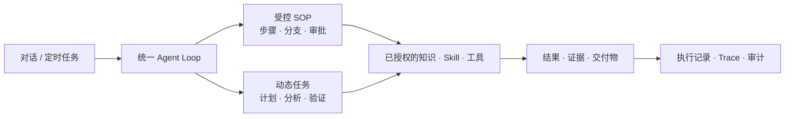

<p align="center">
  
</p>

<h1 align="center">共格·序伴</h1>

<p align="center">
  <strong>让 AI 按流程办事，也能把复杂任务做完</strong><br />
  从个人办公到团队协作的数字员工构建、运行与治理平台
</p>

<p align="center">
  
  
  
</p>

<p align="center">
  <a href="https://github.com/CalmBuilder/gongge-xuban/releases">下载 Windows 版</a> ·
  <a href="#核心亮点">核心亮点</a> ·
  <a href="#开始使用">开始使用</a> ·
  <a href="#文档与源码">文档与源码</a> ·
  <a href="README.en.md">English</a>
</p>

为数字员工配置岗位、模型、知识与工具，在同一个工作台处理**有固定规则的业务流程**和**需要自主拆解的复杂任务**，并保留执行过程、依据与交付结果。

## 核心亮点

- **两种执行方式，一个工作台。** 请假、报销、合同审查由受控 SOP 推进；研究、文档分析和资料整理由动态任务拆解，按目标与成功标准执行。
- **273 个中文专家模板，按岗位选用。** 内置经过审核的 Agency Agents 中文专家包，可从开放广场选用，再绑定岗位需要的知识、Skill、SOP 和工具。
- **带着知识和方法完成工作。** 组合知识引用、`SKILL.md`、HTTP/MCP 工具与附件分析，形成有来源依据的回答和可下载的交付物。
- **等待与恢复有据可查。** 持久保存任务进展，支持澄清、人工审批、外部结果等待、取消和恢复；工作项、执行轨迹与审计记录帮助人接手。
- **把反馈变成下一版能力。** 用户明确分享反馈材料后，管理者可生成隔离的 SOP 改进候选，检查差异并人工发布；历史任务保留原版本。
- **本地上手，按需团队部署。** Windows 安装包内置运行环境；SQLite 支持零配置起步，MySQL 8.4 支持自托管服务，配套租户、角色与组织范围管理。

## 可以交给它什么

| 工作场景 | 任务示例 | 平台如何承接 |
| --- | --- | --- |
| 流程办理 | “帮我发起请假 / 报销 / 权限开通申请。” | SOP 收集信息、条件分支、人工工作项与审批，按节点推进 |
| 文档与研究 | “对比这两份制度，列出差异和依据，生成一份报告。” | 动态计划 + 附件分析 + 知识 / Skill + 交付物验证 |
| 流程中的分析 | “审查这份合同，整理风险后交给负责人确认。” | SOP 保持流程主线，知识与 Skill 支持分析，人工完成关键决定 |
| 定时工作 | “定期整理指定主题的信息并形成简报。” | 定时触发已配置的数字员工，保留执行记录与结果 |
| 团队方法复用 | “把这次 SOP 执行中的问题整理成改进建议。” | 授权反馈材料 → 隔离候选 → 差异确认 → 人工发布 |

以上场景需要配置可用模型，并为相应数字员工绑定知识、Skill、SOP 或业务工具。真实审批和业务系统操作需要部署方完成接口及身份授权接入。

## 开始使用

### Windows：下载安装包

到 [Releases](https://github.com/CalmBuilder/gongge-xuban/releases) 下载 `Gongge-Xuban-windows-x64-setup.exe`，安装后从快捷方式启动。安装包包含应用及 Python、Node.js 等配套运行环境，启动后通过浏览器使用工作台。

首次使用先在管理端配置一个可用模型，再从开放广场选用专家或创建自己的数字员工。模型配置与业务系统凭据由你提供。构建和验收说明见 [Windows 原生验收](packaging/WINDOWS_NATIVE_VALIDATION.md)。

### 源码：本地运行

需要 **Python 3.11+、Node.js 20+ 和 npm**。默认使用 SQLite，无需先安装数据库服务。

```bash
git clone https://github.com/CalmBuilder/gongge-xuban.git
cd gongge-xuban
```

<details>
<summary>macOS / Linux / WSL 初始化</summary>

```bash
cd backend
python3.11 -m venv .venv
source .venv/bin/activate
pip install -e ".[dev]"
test -f .env || cp .env.example .env

cd ../frontend-enterprise
npm ci
cd ..
```

</details>

<details>
<summary>Windows PowerShell 初始化</summary>

```powershell
cd backend
py -3.11 -m venv .venv
.\.venv\Scripts\python.exe -m pip install -e ".[dev]"
if (-not (Test-Path .env)) { Copy-Item .env.example .env }

cd ..\frontend-enterprise
npm ci
cd ..
```

</details>

1. 按 [配置示例](backend/.env.example) 编辑 `backend/.env`，将 `PUBLIC_MOCK_API_KEY` 设置为自己的随机值；已有配置请保留。
2. 在仓库根目录运行 `./app.sh dev`；Windows 使用 `.\app.ps1 dev`。
3. 打开 [对话工作台](http://localhost:5137/chat/) 或 [企业管理端](http://localhost:5137/enterprise/dashboard)，在管理端配置 **OpenAI Chat Completions 兼容模型**。
4. 选用专家或创建数字员工，绑定所需资源，发起第一个任务。服务健康检查为 `http://localhost:5137/api/health`，API 文档为 `http://localhost:5137/docs`。

| 操作 | macOS / Linux / WSL | Windows PowerShell |
| --- | --- | --- |
| 前台开发 | `./app.sh dev` | `.\app.ps1 dev` |
| 后台运行 | `./app.sh` | `.\app.ps1` |
| 查看状态 | `./app.sh status` | `.\app.ps1 status` |
| 停止服务 | `./app.sh stop` | `.\app.ps1 stop` |

## 两种执行方式，如何配合

**受控 SOP** 适合步骤稳定、责任明确、需要审批或业务凭据的任务。**动态任务**适合目标清楚、执行步骤需要现场判断的研究与分析。两者共用 Agent Loop、能力目录和执行治理边界。



| | 受控 SOP | 动态任务 |
| --- | --- | --- |
| 出发点 | 已发布的流程定义与版本 | 用户目标与成功标准 |
| 如何推进 | 收集信息、条件分支、服务节点、人工工作项 | 生成有界计划，组合知识、Skill、工具和附件 |
| 何时等待 | 用户确认、审批、人工办理或外部事件 | 信息缺失、审批、重新授权或外部结果 |
| 如何交付 | 按流程节点记录结果与业务回执 | 验证成功标准、证据与交付物后返回结果 |

对话框可选择 `DynamicTaskAgent` 处理复杂任务；未选择时按现有路由处理。会话已有活动 SOP 时，后续消息继续交给该 SOP；结束后再按当前引擎选择处理。

<details>
<summary>执行约束与恢复机制</summary>

- SOP 使用版本化状态机，支持 `collect_input`、`decision`、`service_task`、`human_task`、`terminal` 等节点，以及候选人、组织范围、防自审和完成门槛。
- 动态任务的普通回答、知识、Skill、附件分析、交付物和只读工具是正常能力基线，不需要通过租户 / 员工 allowlist 额外开通。
- 执行有步骤、模型调用、时间和并发预算；重要进展写入持久记录，配合幂等、租约、重试、恢复信号和外部效果对账。
- `external_write` 与 `destructive` 单独进行授权、可靠性校验、灰度及必要的人工确认。已发出的外部写入即使取消，也仍需确认实际效果。
- `DYNAMIC_TASK_EXECUTION_ENABLED` 是故障处置用的全局 kill switch，正常基线为开启。详细实现见 [动态任务源码](backend/app/dynamic_tasks/) 与 [SOP Runtime](backend/app/sop_runtime/)。

</details>

## 把一次工作沉淀为可复用能力

**数字员工**组合岗位职责、模型、知识、通用 Skill、SOP、工具、记忆与工作记录。开放广场连接个人使用与组织复用，已验证的方法可以发布为团队资产。

- **知识有版本，回答有来源。** 支持文档解析、知识引用和正文修订；候选重建与发布分离，运行中的任务保留已绑定版本，并持续校验访问权限。
- **记忆可管理。** 支持来源追溯、查询、提取状态和清除，按权限与作用域提供后续上下文。
- **改进由人确认。** 用户先预览并明确分享反馈材料，管理者再基于可证明的 SOP 来源编辑候选、确认差异和发布。历史任务继续使用原发布版本。

反馈材料分享不自动开放原会话全文；SOP 改进候选与活动版本隔离。详见 [反馈材料](backend/app/feedback/README.md) 与 [SOP 编辑、候选和发布](backend/app/skills/README.md)。

## 连接现有能力与工作入口

| 能力 | 可以接入什么 | 使用方式 |
| --- | --- | --- |
| 通用 Skill | 以 `SKILL.md` 为核心的方法与可运行能力包 | 启用新版导入后，可从本地文件、ZIP 或固定 GitHub 版本导入，再审核、发布并固定修订 |
| HTTP / MCP 工具 | 内部系统 API、外部服务与 MCP 工具 | 绑定到数字员工，声明权限、风险类别和可靠性契约 |
| 全网情报员 | 网页、搜索及多平台内容读取能力 | 在对话中选择能力包；部分渠道需要配置服务、登录连接或浏览器会话 |
| 企业微信 | 员工已有的沟通入口 | 配置回调、发送者映射和员工绑定，接收任务并通过受控路径回复 |
| Slack | 连接身份与频道基础信息 | 配置 Token / OAuth 连接，按授权读取基础信息 |
| 定时任务 | 周期性知识整理、研究与工作任务 | 设置数字员工与触发计划，在工作台查看执行记录 |

新版 Skill 导入需设置 `GENERAL_SKILL_IMPORT_V2_ENABLED=true`。指导型 Skill 用于提供专业方法；可执行 Skill 另受依赖、权限和运行环境约束，Windows 与打包版使用 Python runner，不支持 Bash runner。

内置中文专家基于 [Agency Agents](https://github.com/msitarzewski/agency-agents) 的固定快照，随版本交付，不在运行时自动同步 GitHub。全网情报员参考 [Agent-Reach](https://github.com/Panniantong/Agent-Reach)，由项目内适配器执行；实际可用渠道取决于配置与外部服务状态。

## 部署与技术栈

| 层次 | 当前实现 |
| --- | --- |
| 工作台 | React 18 · TypeScript strict · Vite · Tailwind CSS |
| 服务与执行 | Python 3.11+ · FastAPI · Agent Loop · SOP / DynamicTask Runtime |
| 本地与桌面存储 | SQLite，零配置默认 |
| 团队服务存储 | MySQL 8.4 · SQLAlchemy / SQLModel · Alembic |
| 桌面构建 | PyInstaller，提供 Windows / macOS / Linux 构建脚本；可下载产物以 Releases 为准 |

应用与数据库可以运行在本地或自有服务器；使用云端模型或外部工具时，相应调用数据仍会发送给配置的服务方。配置优先级为 **操作系统环境变量 → `backend/.env` → 默认值**。

MySQL 部署需要在 `backend/.env` 配置专用应用账号的 `DATABASE_URL`。启用仓库 MySQL 服务并迁移：

```bash
docker compose up -d mysql
./db.sh
```

`./db.sh check` 只读检查迁移版本。启动器在服务启动前进行不超过 10 秒的 MySQL 迁移检查；数据库版本落后时会提示先运行 `./db.sh`。SQLite 使用桌面兼容初始化路径。完整配置见 [后端说明](backend/README.md)。

## 文档与源码

| 入口 | 内容 |
| --- | --- |
| [后端开发](backend/README.md) · [前端开发](frontend-enterprise/README.md) | 安装、配置与开发调试 |
| [统一 Agent Loop](backend/app/core/agent_loop.py) | 路由、SSE、能力编排、取消与结果落盘 |
| [SOP Runtime](backend/app/sop_runtime/) · [动态任务](backend/app/dynamic_tasks/) | 状态机、计划、持久执行、等待与恢复 |
| [通用 Skill](backend/app/general_skills/) · [内置专家](backend/app/experts/builtin.py) | 导入、审核、固定修订与专家资源 |
| [知识](backend/app/knowledge/) · [记忆](backend/app/memory/) | 知识版本、检索引用与记忆治理 |
| [反馈材料](backend/app/feedback/README.md) · [SOP 编辑与发布](backend/app/skills/README.md) | 授权分享、隔离候选与人工发布 |
| [企业连接](backend/app/connectors/) · [垂直能力](backend/app/vertical_abilities/) | 企业微信 / Slack 与全网情报员 |
| [桌面打包](packaging/) · [Windows 原生验收](packaging/WINDOWS_NATIVE_VALIDATION.md) | 构建、签名、安装与启动验收 |

公开入口以 README、源码、测试和模块说明为准。本地设计与验收材料、`agency-agents-library/` 历史导入包不随 GitHub 源码发布；产品所需内置专家固定包由发布 spec 显式打入桌面包。

<details>
<summary>开发检查</summary>

```bash
cd frontend-enterprise
npm run brand:check:test
npm run brand:check
npm run i18n:check
npm run test:run
npm run build

cd ../backend
.venv/bin/ruff check .
.venv/bin/pytest
```

浏览器回归先执行 `npm run test:e2e:install`。MySQL 集成测试需要测试管理员连接；未配置时按预期跳过。自动化检查不替代真实模型、企业系统和审批联调。

</details>

## 使用边界与参与

模型输出和证据引用仍需按业务要求核验。真实业务系统需要配置认证、最小权限与对账能力；外部 Skill 和生成代码需要经过来源、依赖与运行环境审查。多数字员工自动协作、复杂多级会签及受监管流程可能需要额外集成或开发。

欢迎提交问题、使用反馈与改进建议：[Issues](https://github.com/CalmBuilder/gongge-xuban/issues)。参与开发前请阅读 [AGENTS.md](AGENTS.md)，保持租户隔离、版本 / 幂等、执行状态和 SQLite / MySQL 兼容边界。
